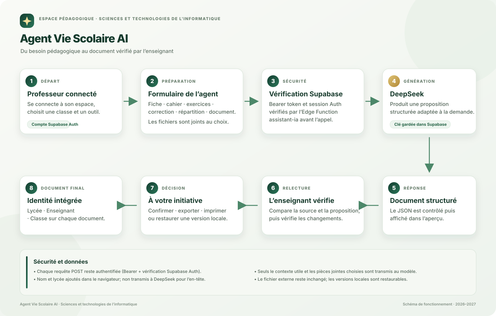

# Agent Vie Scolaire AI — installation et activation

L’**Agent Vie Scolaire AI** est l’assistant pédagogique intégré à Vie Scolaire. Il s’ouvre dans une grande fenêtre de travail, récupère le contexte nécessaire, appelle Gemini par une fonction serveur et produit des documents que l’enseignant peut vérifier, remplacer, exporter ou appliquer.

Chaque document comporte un en-tête **Lycée · Enseignant (nom complet) · Classe**. Le nom du professeur et le lycée sont ajoutés dans le navigateur; ces champs d’en-tête ne sont pas envoyés à Gemini.

## Outils inclus

- **Fiche pédagogique** : objectifs, prérequis, phases de 2 h, notions, évaluation, travail et remédiation ; insertion ou remplacement de la préparation d’une séance après confirmation.
- **Séries d’exercices** : énoncés théoriques ou pratiques, questions, corrigés et barème ; export HTML et impression. Une série récente de l’historique local peut être remplacée après relecture et confirmation; une série externe peut être collée comme référence.
- **Correction de copies** : choix explicite entre devoir **théorique** et **pratique** ; texte, photos, captures et fichiers HTML/CSS/JS/PHP/SQL/TXT/JSON pour le pratique. Pour les copies théoriques photographiées, l'agent transcrit d'abord les réponses sans les noter. La transcription est éditable; les passages incertains sont signalés et l'enseignant doit confirmer explicitement s'il poursuit malgré l'avertissement. La correction utilise ensuite le texte relu, sans renvoyer les photos lors du second appel. Barème fourni par l'enseignant ou proposé d'abord par l'agent puis modifiable avant correction. Justification question par question, limites de l'analyse, note proposée et remédiation. Le code n'est jamais prétendu exécuté et aucune note n'est saisie automatiquement.
- **Cahier de textes** : reformulation limitée au contenu réellement déclaré ; une entrée déjà remplie peut être remplacée après confirmation, sans confirmer automatiquement la séance.
- **Répartition** : proposition séance par séance avec dates et numéros inchangés ; seules les séances futures peuvent recevoir la proposition.
- **Autres documents** : texte collé ou import TXT, Markdown et HTML (PDF/DOCX non extraits). La source et la version complète proposée sont comparées côte à côte. Une confirmation explicite enregistre le résultat et la source dans l’historique local; chaque version précédente reste restaurable. L’agent ne modifie pas le fichier externe : exportez le résultat pour le remplacer vous-même.
- **Prompts partagés** : l’administrateur peut demander trois brouillons génériques à Claude, les modifier, puis en approuver un ou plusieurs. Les professeurs connectés choisissent ensuite jusqu’à cinq prompts publiés pour les demandes Gemini correspondantes.

## Architecture

```text
Professeur connecté
  → formulaire Agent Vie Scolaire AI (outil, classe, demande et pièces choisies)
  → Edge Function assistant-ia (Bearer + session Supabase Auth vérifiés)
  → Google Gemini API `generateContent`
  → JSON contrôlé, aperçu relu par l’enseignant
  → comparaison avant/après, confirmation, restauration locale, insertion, impression ou export
```



La clé de l’IA est un **secret Supabase**. Elle n’apparaît ni dans GitHub, ni dans le JavaScript, ni dans les réponses de la fonction. Le nom complet de l’enseignant et le lycée sont ajoutés à l’en-tête côté navigateur; ils ne sont pas transmis au modèle pour cette mise en forme.

## Prompts partagés : Claude → validation → Gemini

Le flux est volontairement séparé en deux fournisseurs :

```text
Administrateur → prompt-manager côté serveur → Claude : outil + description générique fixe
             ← trois brouillons privés ←
Administrateur relit/modifie et clique « Approuver et partager »
             → bibliothèque Supabase commune (prompts publiés uniquement)
Professeur connecté choisit des prompts → assistant-ia vérifie leurs identifiants et leur statut
             → Gemini reçoit la demande pédagogique et les consignes approuvées
```

- Claude n’est appelé que lorsque l’administrateur clique sur **Demander 3 brouillons génériques à Claude**. La fonction serveur construit une consigne fixe à partir de l’outil choisi, de son objectif général et du format JSON attendu. Elle ignore les autres champs de la requête : aucune demande, sujet réel, copie, image, document, donnée d’élève ou profil professeur ne lui est transmis.
- Les propositions restent des brouillons privés jusqu’à l’action **Approuver et partager**. L’administrateur peut les modifier avant publication. Les professeurs peuvent sélectionner plusieurs prompts publiés (cinq au maximum) pour une tâche; l’Agent les vérifie à nouveau côté serveur et les ajoute uniquement aux consignes envoyées à Gemini.
- Les appels Claude sont **payants** selon l’offre Anthropic. Claude ne participe jamais au traitement d’une demande pédagogique et ne peut pas résoudre une surcharge ou un code 503 Gemini.
- La clé ne doit jamais être ajoutée au navigateur, au dépôt ou au chat. Dans Supabase → Edge Functions → Secrets, configurer `ANTHROPIC_API_KEY` et `ANTHROPIC_MODEL` (un identifiant de modèle disponible sur le compte Anthropic). Le modèle doit être configuré explicitement; il n’y a pas de valeur supposée par défaut.
- La migration préparée `supabase/migrations/20261026_agent_prompt_library.sql` crée la table commune et ses règles RLS. **Elle n’a pas été appliquée** : demander une confirmation explicite avant toute exécution sur la base Supabase distante. Le fichier `supabase/schema.sql` inclut également cette structure pour une nouvelle base.
- Après approbation de la migration et configuration des secrets, déployer `prompt-manager` et redéployer `assistant-ia`. `prompt-manager` garde sa vérification JWT par défaut et vérifie aussi la session et `ADMIN_EMAILS`; la configuration `verify_jwt = false` reste limitée à `assistant-ia`, qui conserve son contrôle interne `authenticatedUser()`.

## 1. Choisir le modèle

La fonction appelle directement l’API **Google Gemini `generateContent`**. Il faut un modèle Gemini qui prend en charge les images et le mode JSON : ces capacités sont nécessaires à la transcription manuscrite et aux documents structurés.

Réglages disponibles dans les secrets Supabase :

| Secret | Rôle |
|---|---|
| `GEMINI_API_KEY` | Clé privée Gemini — obligatoire. Le projet Supabase actuel possède déjà ce secret. |
| `GEMINI_MODEL` | Identifiant du modèle à utiliser — facultatif; par défaut `gemini-3.8-flash`. |
| `GEMINI_MODELE` | Ancien nom accepté pour le réglage du modèle, afin de rester compatible avec `corriger-ia`. |
| `GEMINI_MAX_OUTPUT_TOKENS` | Limite de réponse, de 1000 à 12000; facultatif. |

Le modèle par défaut est `gemini-3.8-flash`. Si ce modèle n’est pas disponible sur votre compte, définissez `GEMINI_MODEL` avec un modèle Gemini prenant en charge les images et la sortie JSON :

```bash
supabase secrets set GEMINI_MODEL="MODELE_GEMINI_DISPONIBLE"
```

La clé API reste un secret côté serveur; ne la communiquez pas dans une conversation, un ticket ou un fichier du dépôt. Si `GEMINI_API_KEY` n’existe pas ou doit être renouvelée, ajoutez-la directement dans Supabase → Edge Functions → Secrets.

## 2. Déployer la fonction

Depuis la racine du projet, avec la CLI Supabase et un compte ayant accès au projet :

```bash
supabase login
supabase link --project-ref oaahxobzbnmaohcmdrbu
supabase functions deploy assistant-ia --project-ref oaahxobzbnmaohcmdrbu
```

La fonction utilise `verify_jwt = false` au gateway pour que le précontrôle CORS `OPTIONS`, qui ne contient pas de jeton, puisse atteindre la fonction. Cela ne rend pas les générations anonymes : `assistant-ia/index.ts` exige un Bearer token et vérifie chaque `POST` auprès de Supabase Auth. Ne supprimez pas ce contrôle d’authentification dans le code.

Pour activer la bibliothèque partagée, appliquer d’abord la migration uniquement après confirmation explicite, configurer les secrets Claude côté Supabase, puis déployer :

```bash
supabase functions deploy prompt-manager --project-ref oaahxobzbnmaohcmdrbu
supabase functions deploy assistant-ia --project-ref oaahxobzbnmaohcmdrbu
```

Ne créez pas de réglage `verify_jwt = false` pour `prompt-manager`. Cette nouvelle fonction vérifie elle-même la session; seules les opérations de brouillon, publication et retrait exigent en plus un courriel présent dans `ADMIN_EMAILS`.

Après le déploiement, la fonction est appelée automatiquement à partir de l'URL Supabase déjà configurée dans l'application :

```text
https://oaahxobzbnmaohcmdrbu.supabase.co/functions/v1/assistant-ia
```

## 3. Publier l'interface

Ajouter au dépôt les fichiers modifiés, notamment :

```text
assets/agent-sti.js
assets/agent-sti.css
assets/agent-vie-scolaire-flux.svg
supabase/functions/assistant-ia/index.ts
supabase/config.toml
index.html
assets/app.js
assets/interface-reference.js
sw.js
AGENT_IA.md
```

Puis publier sur la branche utilisée par GitHub Pages. La version du service worker a été incrémentée pour éviter que les appareils conservent l'ancienne interface en cache.

## 4. Vérifier le fonctionnement

1. Ouvrir Vie Scolaire et se connecter avec le compte professeur.
2. Ouvrir **Agent Vie Scolaire AI** dans le menu principal.
3. Cliquer sur **Tester la connexion**. Le modèle configuré doit apparaître.
4. Générer d'abord une courte série théorique, puis une courte série pratique pour vérifier l'adaptation au type de devoir.
5. Tester une correction théorique avec une copie fictive et un barème fourni.
6. Tester une copie manuscrite fictive en photo : relire et modifier la transcription; si un passage est signalé, vérifier l'avertissement et la confirmation avant de poursuivre.
7. Tester une correction pratique avec de petits fichiers de code anonymisés : choisir **L’agent propose le barème**, relire et modifier la proposition, puis lancer la correction. Vérifier que le rapport distingue bien l'analyse du code du fonctionnement à tester.
8. Tester un document libre court collé ou importé en TXT, Markdown ou HTML; comparer l’avant/après, annuler une première confirmation, puis enregistrer et restaurer une version. Un PDF ou DOCX doit être copié en texte; aucun extracteur binaire n’est utilisé.
9. Vérifier les points et les faits avant toute application ou export.

## Protection des données

- Envoyer uniquement la séance, le thème ou la copie nécessaire à la demande ; l'agent n'envoie pas la base complète des élèves.
- Utiliser des identifiants anonymes (« Copie 1 ») plutôt que les noms complets.
- Les images sont réduites dans le navigateur, limitées à six par demande, puis transmises à la fonction pour l'analyse. Pour une copie manuscrite théorique, elles servent d'abord à la transcription; après relecture, le second appel de correction reçoit le texte et non les photos.
- Les fichiers de code sont limités à huit fichiers de 200 Ko chacun ; ils sont lus localement et ne sont pas enregistrés dans l'historique.
- Les corrections et les propositions de barème ne sont pas ajoutées à l'historique local des générations.
- Les autres documents récents sont conservés dans l’historique du navigateur, associé au professeur connecté; seules ses entrées sont proposées. Les anciennes entrées sans identité de compte restent stockées mais sont masquées. Une série sélectionnée n’est remplacée qu’après relecture et confirmation; pour un document libre, la source et la proposition ne sont enregistrées qu’après confirmation. Les versions locales précédentes sont conservées et peuvent être restaurées; aucun fichier externe n’est modifié.
- Pour les documents libres, le texte source est transmis à Gemini uniquement lorsque l’enseignant lance la révision. L’import est limité au texte TXT, Markdown et HTML; les PDF/DOCX binaires ne sont pas extraits. L’import ou l’édition du champ ne modifie pas le fichier choisi.
- Le remplacement d’une fiche ou d’une entrée du cahier ouvre une confirmation dédiée; Annuler laisse les données existantes intactes. L’enregistrement final reste à la main du professeur.
- Aucune correction n’est enregistrée dans les notes et aucune séance n’est marquée assurée sans action de l’enseignant.

## Dépannage

| Message | Vérification |
|---|---|
| `Connexion professeur requise` | Se reconnecter depuis le bouton Compte de la plateforme. |
| `Agent non configuré` | Vérifier `GEMINI_API_KEY` dans Supabase → Edge Functions → Secrets. Vérifier aussi que `GEMINI_MODEL` est disponible sur le compte. |
| Code 401 ou 403 de Gemini | Vérifier la clé, le compte et les autorisations du modèle. |
| Le texte fonctionne mais pas les photos | Choisir un modèle Gemini vision et vérifier que les images sont transmises en `inlineData`. |
| Réponse JSON incomplète | Réessayer, réduire la demande ou choisir un modèle Gemini prenant bien en charge le mode JSON. |
| Délai dépassé | Réduire le nombre d'images ou de séances demandées, puis réessayer. |

## Limites volontaires

L'agent propose ; l'enseignant décide. Une correction automatique peut se tromper, notamment sur une écriture manuscrite ou un barème ambigu. Le détail des points, les passages incertains et la justification sont donc toujours affichés pour contrôle.
